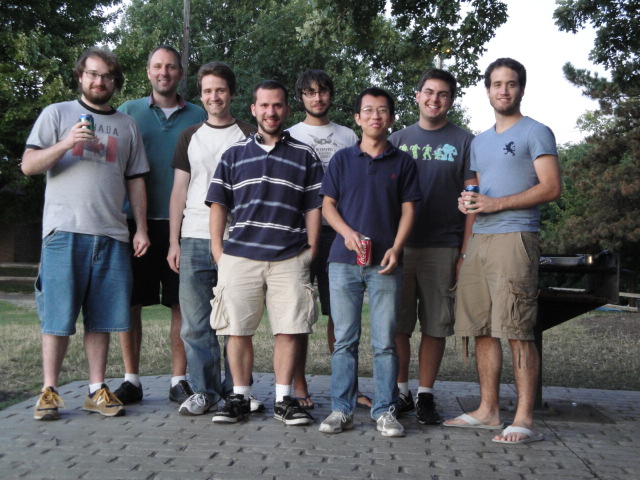
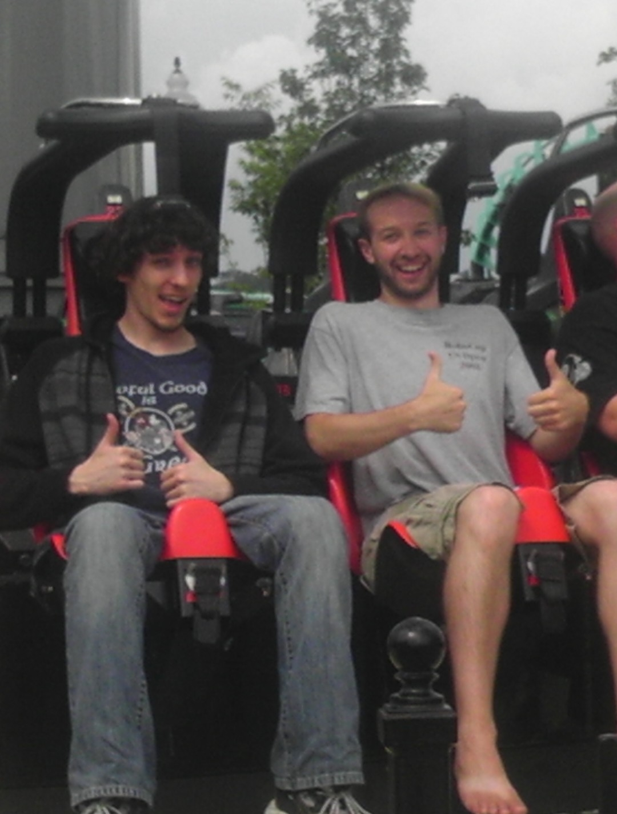
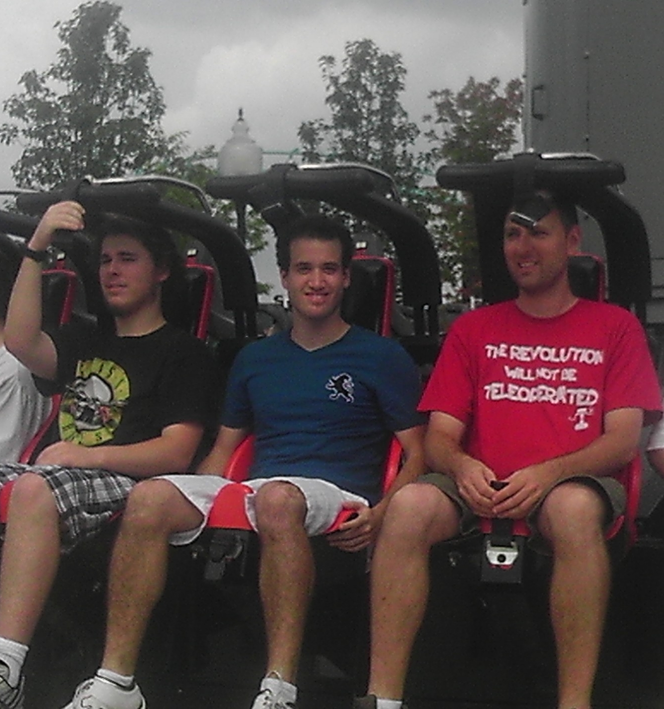
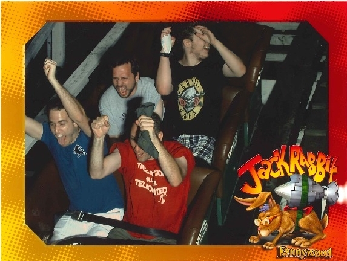

# People

##  Advisor

[Dr. Maxim Likhachev](http://www.cs.cmu.edu/~maxim/)

##  Current Members

[Margarite Safonova](0068-margarite-safonova.html)

[Andrew Dornbush](0015-andrew-dornbush.html)

[Brian MacAllister](0014-brian-macallister.html)

[Jonathan Butzke](0017-jonathan-butzke.html)

[Ben Cohen](http://bcohen.info)

[John Drake](0019-john-drake.html)

[Kalin Gochev](0021-kalin-gochev.html)

[Aline Normoyle](0023-aline-normoyle.html)

[Mike Phillips](https://sites.google.com/site/robotman0/)

[Venkatraman Narayanan](http://www.cs.cmu.edu/~venkatrn/)

[Harsh Pandey](0027-harsh-pandey.html)

[Victor Hwang](0067-victor-hwang.html)

[Arjun Menon](0065-arjun-menon.html)

[Aram Ebtekar](0056-aram-ebtekar.html)

[Kush Prasad](0057-kush-prasad.html)

[Soonkyum Kim](0059-soonkyum-kim.html)

[Sung-Kyun Kim](0058-sung-kyun-kim.html)

[Siddharth Swaminathan](0060-siddharth-swaminathan.html)

[Ellis Ratner](0062-ellis-ratner.html)

[Chen Gao](0061-chen-gao.html)

[Hao Wang](0066-hao-wang.html)

##  Alumni

[Subhrajit Bhattacharya](0016-subhrajit-bhattacharya.html)

[Alex Kushleyev](0026-alex-kushleyev.html)

[Steven Gray](0020-steven-gray.html)

[Bradford Neuman](0022-bradford-neuman.html)

[Sandip Aine](https://sites.google.com/site/sandipaine/)

##

##  Former Members

[Matthew Mac Allister](0029-matthew-mac-allister.html)

[Kavan McEachern](0028-kavan-mceachern.html)

[Eduardo Barrera](0039-eduardo-barrera.html)

Haojie "Tony" Zhang

[Krishna Sapkota](0063-krishna-sapkota.html)

[Burak Yucesoy](0064-burak-yucesoy.html)

#  Pictures of the group

**Lab Cookout (Summer 2011)**

**The group goes to Kennywood (Summer 2012)**

