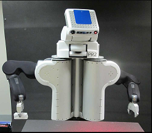
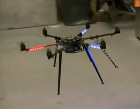
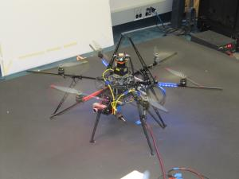
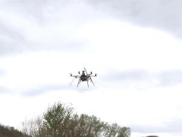
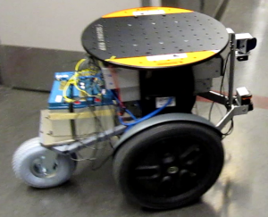
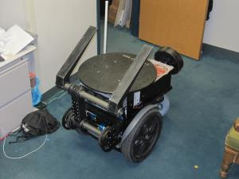
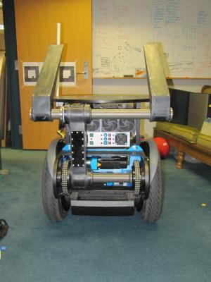

# Robots

##  Allen the PR2:

Allen the PR2 is a mobile manipulation platform developed by Willow Garage ([http://www.willowgarage.com/pages/pr2/overview](http://www.willowgarage.com/pages/pr2/overview)). The robot has two 7 degree of freedom arms for manipulating objects and an omni-directional base for navigation. The robot has an array of sensors including two Hokuyo laser range finders and seven cameras for building 3D maps of its surroundings and identifying objects. In our lab we use Allen to test a variety of planners including single-arm, dual-arm, navigation (in position and orientation), and full-body mobile manipulation.

 

##  Man-Hack the Hexacopter:

Man-Hack the Hexacopter is our lab unmanned aerial vehicle (UAV). The base is a Mikrokopter Hexa XL frame with a custom-made carbon fiber computer carrier and blade guard. The onboard processing is performed by an i7 COM Express module running ROS allowing the Hexacopter to operate without any offboard connectitivity. Similar to Melvin, the hexacopter uses two orthogonally mounted Hokuyo laser range finders as the primary localization sensors augmented by GPS and two wide-angle camera systems. Total system weight is approximately 4.3kg with over 15 minutes of flight time.

 The hexacopter is used for 3-D planning research including planning under uncertainty, planning in the presence of 3-D dynamic obstacles, and visual servoing in conjunction with planning.

 

##  Melvin the Segbot:

Melvin the Segbot is based on a Segway RMP 200 platform with a custom made rear trailer allowing it to operate in a variety of environments both indoors and outdoors. The custom computer system consists of an 8-core server and a 2-core controller giving Melvin the highest computational capability of any of our lab robots. Like all of our robots, Melvin uses the ROS operating system running on Kubuntu for the software infrastructure. For sensing the environment, Melvin relies on two Hokuyo laser range finders which can be supplemented by GPS or vision systems when required.

 Melvin is used primarily for ground navigation research including research in exploration, planning in the presense of dynamic obstacles, and multi-robot planning.
