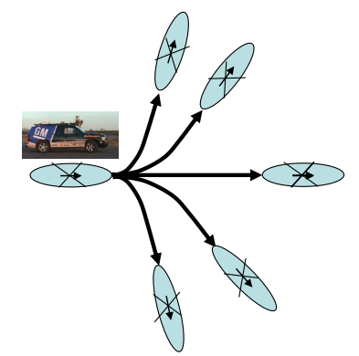
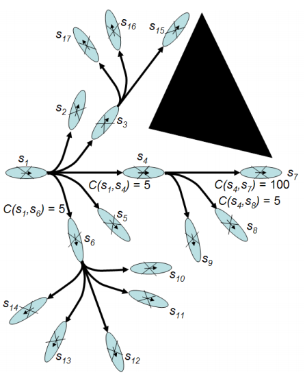

# Kinematic Constraints and Motion Primitives

In the [last article](http://sbpl.net/node/50), we showed how a graph can represent states of the robot. We defined a trajectory or path as a series of adjacent states in a graph. But adjacent states don't reflect the kinodynamic constraints of the robot. For example, let's say a car is facing north at x, y location (2,2). Our path tells us to move from (2,2) to (1,2). While the states are adjacent, our car cannot move sideways to achieve this transition. We could improve this by introducing a theta component, making the state space (x, y, theta). This doesn't entirely fix the problem because the resulting paths might not be smooth (imagine if the theta changed every step of the path). Instead, SBPL uses lattice-based graphs that are constructed using motion primitives. Motion primitives are pre-computed motions that the robot can take.

By superimposing this on the graph at the robot's position, our adjacent states (or what are usually called successors) are not necessarily spatially adjacent. Instead, they represent what the robot can smoothly transition to. The image below shows what this might look like for a robotic car - the motion primitives follow typical car-like motions. Valid successors of a given state are states that can be reached with these motions while not colliding with anything else.

Motion primitives allow us to encode the kinematic constraints of the robot into any environment that the robot is planning in. They also allow for different costs associated with each motion - for example, if we want to avoid reversing the car, we might assign a high cost to that particular motion primitive. SBPL has Matlab tools to build motion primitives for different types of vehicles.

Instructions for how to do this can be found [here](http://sbpl.net/node/52). For more information on lattice planning, see [here](http://www.cs.cmu.edu/~maxim/files/planlongdynfeasmotions_rss08.pdf).
