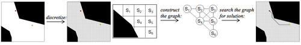

# Primer to Search-Based Motion Planning

This article aims to give a very brief overview of the concepts behind SBPL. See [this wiki article](http://en.wikipedia.org/wiki/Motion_planning) for an intro to motion planning.

**Search-based Planning**

Search-based planning is a motion planning method which uses graph search methods to compute paths or trajectories over a discrete representation of the problem. Because a graph is inherently discrete, all graph-search algorithms require this discrete representation. Search-based planning can then be seen as two problems: how to turn the problem into a graph, and how to search the graph to find the best solution.

This is in contrast to sample-based planning methods, which are able to solve problems in continuous space without a graph representation (though certain sampling-based methods do discretize the space). While the pros and cons between the two methods can be debated for many hours, the most apparent difference between the two methods are speed and optimality: graph-search methods can guarantee how "efficient" a solution is (defined more later), but, in general, does so at the expense of computation time. Sampling based planners run fast, but can result in unusual looking and possibly inefficient paths.

First we talk about how the environment of the problem is discretized, then we describe how planning is done.

**Environments (or discrete representation of a planning problem)**

In order to properly represent the problem with a graph, we first discretize all possible states so that there are a finite number of states a robot could be in. Here, the definition of state varies depending on the application. For a car, you might only be concerned with the x, y, and orientation. For a helicopter, it might be the x, y, z, roll, pitch, and yaw. For a robotic arm, it would be the values of each joint in the arm (joint1, joint2, joint3, joint4). The collection of all possible states is defined as the state space. For the car example, if we have a 50x50 grid of locations it could be in while forcing the car to be in 1 of 4 orientations at all times, we would have a state space of size 50*50*4=10000.

The image below shows a small portion of the state space. Here, each possible (x,y) position that a robot could be in is represented as a node with a state ID (S1, S2, etc). A path for a robot in this state space would then be moving through a series of adjacent states (for example S6, S4, S1).

The graph representation then comes naturally - valid transitions between adjacent states (also called the successors of the state) are represented by edges between the nodes. For now, we assume that any two adjacent states will have a valid transition between them (this is a bit oversimplifying, but it's good enough for now - see the [Kinematic Constraints and Motion Primitives](http://sbpl.net/node/48) section for more details.)

Since the state ID is just a number, environments of nearly any dimension can be discretely represented as a graph.

**State Validity and Collision Checking**

One important notion about the state space is the validity of states. When computing a trajectory, we need all states in the trajectory to be valid. Obviously, the definition of valid becomes very domain dependent.

Looking at the above figure, which represents the 2D environment, we see that there are states that are invalid - if the blacked out regions are buildings, we certainly wouldn't want to be traveling through them. In this case, those states are obviously invalid. More specifically, the robot would be in collision with the building. The same idea occurs in the robotic arm domain - given a particular set of joint angles for an arm, does it collide with anything in the environment? In both cases, we need logic that takes in knowledge about the robot's surrounding environment and a given state. It then returns a value telling us whether we are in collision or not (or synonymously, if the state is valid).

More constraints can be added as needed to the requirements of a valid state. Let's take the case where we have a robotic arm with the same joints and joint limitations as a human arm. We need to make an extra state validity check beyond just seeing if we collide with anything in the environment. If we had a list of states with the elbow joint going from 0 degrees to 270 degrees, many of those states would be invalid - elbows only have a 180 degree range (or have a joint limit of 180 degrees). Therefore, states specifying an elbow angle from 181-270 would be deemed invalid.

Before moving on to searching this graph, it's important to note that the translation between the "real world" context and what the graph looks like is completely decoupled from how the problem is solved. Because each state is encoded into a single identifying number (state IDs), the graph searching algorithm doesn't need to know what the original domain was - all it needs are these state IDs. This decoupling of the environment from the graph allows the graph search algorithm to operate on any problem that can be represented as a graph.

**Planners**

Now that we have a basic concept of what the graph represents, we can look at methods for solving the motion planning problem. The simplest approaches to this would be using Dijkstra's or the A* algorithm, which returns the shortest possible path between a given start and goal. However, this can be slow and memory expensive. Instead, we can find a suboptimal solution, or a path from the start to goal that isn't necessarily the best one. In most cases, we don't need to have the best path - we just need one that's good enough. This relaxes the conditions on the graph search and allows us to find a good-enough solution in much less time with much less memory. One algorithm that does this is weighted A*.

This parameter of "good enough" is often denoted as epsilon of the best solution. If we allow an epsilon of 5, this means that the weighted A* algorithm will return a path that is no worse than 5 times the cost of the optimal solution. This concept of suboptimality is fundamental to how SBPL planners work.

 

The three animations here depict a Dijkstra search, an A* search, and a weighted A* search. The speed and memory usage (in terms of number of nodes that are expanded) of each can easily be seen. Dijkstra's is the slowest and expands the most number of states. The vanilla A* is a bit better, and computes an optimal path as well (though in this case, it's not the same as Dijkstra's because there is more than one optimal path). Weighted A* runs the fastest, but does not return the best solution.

With the ARA* algorithm, we can have the best of both worlds - a suboptimal solution can be returned very quickly (high epsilon), and then ARA* can continue working to return a lower epsilon solution for a user specified amount of time.

[SBPL also implements a number of different algorithms (ARA*, AD*, R*, D* Lite, etc) that produce paths with user-specified epsilons. The differences between the algorithms are described in this future article.]

So what does SBPL actually do? SBPL computes the exact motion path for a robot to follow in order to get from point A to point B. Furthermore, SBPL allows us to trade off how good the path is versus how long it takes to compute. If we care about computation time (like if our robot car is driving really fast), we reduce the optimality of the path. If the car's driving slowly, and we'd like shorter paths, then we can allot more time for the planner to run.
