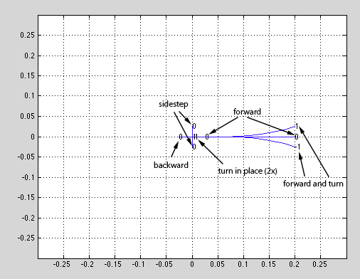
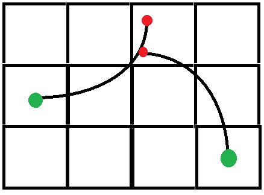

# Generating Motion Primitives with SBPL

In this article, we'll talk about how to generate motion primitves that SBPL uses for its lattice planning. For an introduction to motion primitives, see [this article](http://sbpl.net/node/48).

**Visualizing motion primitives**

In the

```

matlab/mprim/
```

folder of sbpl, you'll find numerous files of the form

```

genmprim_*
```

These files generate different sets of motion primitives a robot could use. To start, open up matlab and run one of these:

```

 >>> genmprim output.mprim
```

A window similar to the one shown below should appear which shows the motion primitives for a variety of angles. If you hit <enter> in the matlab window, you'll see the visualizations increment. As your keep on hitting <enter>, you'll see all the primitives that are generated.

**Decoding the genmprim.m script**

At the top of the script, you'll see the following declarations:

```

if UNICYCLE_MPRIM_16DEGS == 1
    resolution = 0.025;
    numberofangles = 16; %preferably a power of 2, definitely multiple of 8
    numberofprimsperangle = 9;

```

**Resolution** denotes the resolution of your map.

**numberofangles** denotes how many discrete states a full 360 degree rotation should be discretized into.

**numberofprimsperangle** denotes how many different motions the robot can take for a given discretized angle.



To put these parameters into perspective, let's look at the labeled image above. The image shows motion primitives for 1 of the 16 discretized angles (angle = 0). There are 9 different paths the robot can take for a given angle, which are organized into the following categories: forward, forward and turn, sidestep, backward, and turn in place. Note that there are actually two turn in place actions (clockwise and counter clockwise), but this does not show up well in the image. Also, we have two motion primitives for moving forward: one that moves 1 unit, and another that moves 8 units (this tends to speed up the search if chosen well). Since the rotation is discretized into 16 states with 9 primitives for each, the robot will have a total of 144 motion primitives.

**Multipliers**

```

    %multipliers (multiplier is used as costmult*cost)
    forwardcostmult = 1;
    backwardcostmult = 5;
    forwardandturncostmult = 1;
    sidestepcostmult = 50;
    turninplacecostmult = 50;

```

The multipliers allow the user to define preferred actions. For example, if the robot is slow to move backwards, one would raise the cost multiplier on the backwards cost.

**Motion Vectors**

In order to define the actual motions, we use delta position vectors. The below is taken from genmprim_unicycleplussideways.

```

    %note, what is shown x,y,theta *changes* (that is, dx,dy,dtheta and not absolute numbers)

    %0 degreees
    basemprimendpts0_c = zeros(numberofprimsperangle, 4); %x,y,theta,costmult
    %angles are positive counterclockwise
    %0 theta change
    basemprimendpts0_c(1,:) = [1 0 0 forwardcostmult];
    basemprimendpts0_c(2,:) = [8 0 0 forwardcostmult];
    basemprimendpts0_c(3,:) = [-1 0 0 backwardcostmult];
    %1/16 theta change
    basemprimendpts0_c(4,:) = [8 1 1 forwardandturncostmult];
    basemprimendpts0_c(5,:) = [8 -1 -1 forwardandturncostmult];
    %turn in place
    basemprimendpts0_c(6,:) = [0 0 1 turninplacecostmult];
    basemprimendpts0_c(7,:) = [0 0 -1 turninplacecostmult];
    %sideways maintaining the same heading
    basemprimendpts0_c(8,:) = [0 1 0 sidestepcostmult];
    basemprimendpts0_c(9,:) = [0 -1 0 sidestepcostmult];

    %45 degrees
    basemprimendpts45_c = zeros(numberofprimsperangle, 4); %x,y,theta,costmult (multiplier is used as costmult*cost)
    %angles are positive counterclockwise
    %0 theta change
    basemprimendpts45_c(1,:) = [1 1 0 forwardcostmult];
    basemprimendpts45_c(2,:) = [6 6 0 forwardcostmult];
    basemprimendpts45_c(3,:) = [-1 -1 0 backwardcostmult];
    %1/16 theta change
    basemprimendpts45_c(4,:) = [5 7 1 forwardandturncostmult];
    basemprimendpts45_c(5,:) = [7 5 -1 forwardandturncostmult];
    %turn in place
    basemprimendpts45_c(6,:) = [0 0 1 turninplacecostmult];
    basemprimendpts45_c(7,:) = [0 0 -1 turninplacecostmult];
    %sideways maintaining the same heading
    basemprimendpts45_c(8,:) = [-1 1 0 sidestepcostmult];
    basemprimendpts45_c(9,:) = [1 -1 0 sidestepcostmult];

    %22.5 degrees
    basemprimendpts22p5_c = zeros(numberofprimsperangle, 4); %x,y,theta,costmult (multiplier is used as costmult*cost)
    %angles are positive counterclockwise
    %0 theta change
    basemprimendpts22p5_c(1,:) = [2 1 0 forwardcostmult];
    basemprimendpts22p5_c(2,:) = [6 3 0 forwardcostmult];
    basemprimendpts22p5_c(3,:) = [-2 -1 0 backwardcostmult];
    %1/16 theta change
    basemprimendpts22p5_c(4,:) = [5 4 1 forwardandturncostmult];
    basemprimendpts22p5_c(5,:) = [7 2 -1 forwardandturncostmult];
    %turn in place
    basemprimendpts22p5_c(6,:) = [0 0 1 turninplacecostmult];
    basemprimendpts22p5_c(7,:) = [0 0 -1 turninplacecostmult];
    %sideways maintaining the same heading
    basemprimendpts22p5_c(8,:) = [-1 2 0 sidestepcostmult];
    basemprimendpts22p5_c(9,:) = [1 -2 0 sidestepcostmult];


```

Defining the motion primitives is a little bit tricky due to discretization problems. Intuitively, we'd expect to only define 9 motion primitives that would be used for all 16 of our discrete angles. However, due to angle discretization error, a motion primitive defined for a robot oriented at 0 degrees may not be the best motion primitive for a robot oriented at 22.5 degrees. We'll address why this is in a bit.

In order to combat this, we define each angle (for one quadrant) explicitly. Since we have a total of 16 discretized angles, we can get away with defining 4 of the angles for quadrant one, and then duplicating the motions for the other three quadrants. Thus, we only need to define motion primitives for 4 angles: 0, 22.5, 45, and 67.5. We can take advantage of symmetry again and say that angles 22.5 and 67.5 can use the same set of motion primitives (as their discretization errors will be the same). In this code, we define motion primitives for 22.5 degrees.

Now, we only have to define motion primitives for 3 angles: 0, 22.5, and 45. With 9 motion primitives for each, this means we must define 27 motion primitives. Looking above, we see that there are indeed 27 definitions. Let's look at the definition for moving forward 8 units when the robot is oriented at 0 degrees:

```

basemprimendpts0_c(2,:) = [8 0 0 forwardcostmult];
```

The format for this vector is [dx dy dtheta multiplier]. Since we're facing down the positive x-axis, we want dx=8, and everything else 0. For the same motion when the robot is oriented at 45 degrees, we use:

```

basemprimendpts45_c(2,:) = [6 6 0 forwardcostmult];
```

Notice that the distance traversed is actually more than 8 (8.48). This is to counteract the previously described discretization error. This extra distance ensure that we land in the center of the discretized cell, rather than off to one corner. When designing your own motion primitives, it's important to make sure your motions land you in the centers of cells to avoid discontinuous paths. The image below depicts what happens when your motion primitives don't land in the middle of the cell - even though it's valid in discrete space, the continuous path is invalid (thanks Andrew Dornbush).



Once you've defined your set of motion primitives, use the matlab visualization to ensure that the motions are correct. The generated file (usually ending with .mprim) is now ready for use by the SBPL planner!
