# Forward Arc Motion Primitives

##  SBPL Forward-Turn-Arc Motion Primitive Generation

 (Margarita Safonova)

SBPL Lattice Planner generates a path from start to goal by combining a series of pre-defined motion primitives. SBPL provides several matlab scripts that can be used to build motion primitives for different types of vehicles. For example, the matlab script named genmprim_unicycle.m constructs forward, backward, turn-in-place, and forward-turn-arc motion primitives for a unicycle robot in the 3D state space (x,y,θ). In this tutorial we describe how the genmprim_unicycle.m script calculates the forward-turn-arc motion primitive given the start and the end poses.

###  **1  Introduction**

The task of the SBPL Lattice Planner is to generate a smooth kinematically feasible trajectory or path, that a robot can safely follow to reach its goal pose. This trajectory is represented as a series of connected states in a lattice-based graph constructed using motion primitives and efficient search algorithms. A lattice-based graph is a graph constructed using short motion primitives as edges that end up at the center of cells. Motion primitives are short, kinematically feasible motions which form the basis of movements that can be performed by the robot platform.

Figure 1 shows the base set of motion primitives used by the planner (left), the lattice-based graph construction process (middle), and the final generated path (right). Each state is represented in the 3D space by a pose with two-dimensional coordinates (x,y) and orientation θ.

---

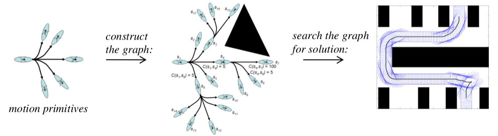

 Figure 1: Lattice-based graph representation for 3D(x,y,θ) planning.

---

The genmprim_unicycle.m matlab script constructs a set of motion primitives that enable a robot to move straight forward, straight backward, turn in place by a certain angle and move forward and turn by a certain angle. The script generates primitives for a discrete set of turning angles φ, varying from 0 to 2π radians. The set of primitives generated for each turning angle φ can include two forward primitives (short and long), one backward primitive (short), two turn in place primitives (clockwise and counterclockwise) and two forward-turn-arc primitives (clockwise and counterclockwise). All motion primitives share the same starting point (x = 0, y = 0), but have different starting orientations. Motion primitives within the same set have the same starting orientation (θ = φ) equal to the turning angle of the set. Each individual motion primitive is defined by its type, its start pose, its end pose and contains a dense sequence of poses forming a trajectory in the 3D space (x,y,θ). The matlab script writes all generated primitive trajectories into a file. This file is later used by the SBPL Lattice Planner to generate trajectories.

###  **2  Matlab Script Description**

The matlab script uses several configurable parameters:

   (a)  outfilename - name of the file (usually with extention .mprim) where generated set of motion primitives is saved. This parameter is required and must be passed to the script as an argument.  (b)  resolution - cell size of the (x,y) grid in meters (0.1 by default).  (c)  numberofangles - number of discrete angles per circle (16 by default). This number preferably should be a power of 2 and definitely should be multiple of 8. This parameter determines the base turning angle calculated as δ = 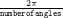 and the set of turning angles as φ = kδ, where 0 ≤ k ≤ numberofangles−1.  (d)  numberofprimsperangle - number of primitives per set (5 by default). By default turn in place primitives are not generated. To add them set this parameter to 7.  (e)  numofsamples - number of discrete points on each primitive trajectory (10 by default).

The turning angle of the motion primitive set (φ) and the base turning angle (δ) together define the orientation (θ) of the end pose for each motion primitive in the set:

<table class="equation">
	<tbody>
		<tr>
			<td>
				

					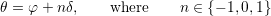</img>

			</td>
			<td class="equation-label">
				(1)</td>
		</tr>
	</tbody>
</table>

The script defines a set of end poses for a subset of starting angles in the first quadrant. These form the basis for all motion primitives that are generated for a discrete set of angles.

   (a)  basemprimendpts0_c - the array of end poses for the starting angle φ = 0∘.  (b)  basemprimendpts45_c - the array of end poses for the starting angle φ = 45∘.  (c)  basemprimendpts22p5_c - the array of end poses for the starting angle φ = 22.5∘.

In the script, each of these arrays of end poses is defined as an array of four-dimensional vectors (i,j,n,costmultiplier), where i and j specify x and y coordinates of the end pose in grid units (x = i∗resolution, y = j∗resolution), n determines the orientation of the end pose (see (1)) and costmultiplier is a cost multiplier value used by the SBPL Lattice Planner to penalize certain types of motion primitives.

It is important for each motion primitive to start and end exactly in the center of a grid cell to avoid having discontinuities in the path generated by the lattice planner. (As an implementation detail, the matlab script actually generates primitives that start and end at the corners of grid cells. The planner then shifts motion primitive trajectories by 0.5∗resolution in each direction to move their start/end points to the centers of the grid cells.)

The rest of motion primitives are constructed as a result of symmetrical rotation of one of the base primitives around the origin by a certain angle which is a multiple of the base turning angle (δ). The disposition of the end pose relative to the origin determines the shape, the length and the turning angle of the primitive. By specifying appropriate end pose and base turning angle, we can control the kinematic feasibility of motion primitives.

In each set, the forward and backward primitives have fixed orientation and are represented by simple straight line segments. The two turn in place primitives have (x,y) coordinates of the end pose equal to (x,y) coordinates of the start pose, and simply demonstrate change in the orientation. The two forward-turn-arc primitives have ending orientations symmetrical with respect to the forward primitive: θ1,2 = φ ± δ. Due to the requirement to reach exactly the given end pose (x,y,θ), each forward-turn-arc primitive is constructed as combination of two movements: a forward straight line segment followed by an arc of a circle. Figure 2 illustrates the base set of motion primitives for turning angle φ = 0∘. Figure 3 displays the full set of motion primitives generated by the genmprim_unicycle.m matlab script.

The matlab scripts records information about all generated motion primitives into a file specified by outfilename. First it writes data related to all motion primitives:

   (a)  resolution_m - cell size of the (x,y) grid in meters.  (b)  numberofangles - number of discrete angles per circle.  (c)  totalnumberofprimitives - total number of generated motion primitives.

Then in a loop, the scripts outputs information applicable to each individual motion primitive:

   (a)  primID - unique identifier of the motion primitive.  (b)  startangle_c - starting orientation of the motion primitive (θ).  (c)  endpose_c - end pose of the motion primitive (x,y,θ).  (d)  additionalactioncostmult - cost multiplier of the motion primitive.  (e)  intermediateposes - number of generated poses for the motion primitive.  (f)  - list of actual intermediate poses generated for the motion primitive (x,y,θ). Notice that these poses are calculated with respect to the origin (0, 0), not the center of the grid cells.

---

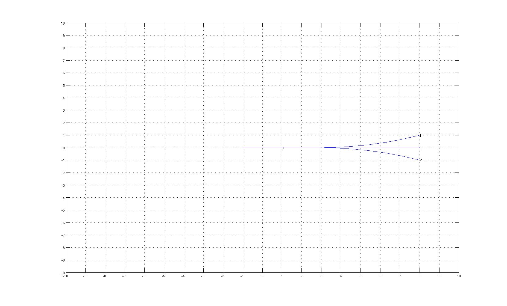

 Figure 2: Base set of motion primitives for turning angle φ = 0∘. Here 0 denotes forward and backward straight motion primitives, 1 denotes the counterclockwise forward-turn-arc motion primitive with the ending orientation θ1 = φ + δ = 22.5∘, and −1 denotes the clockwise forward-turn-arc motion primitive with the ending orientation θ2 = φ − δ = −22.5∘.

---

---

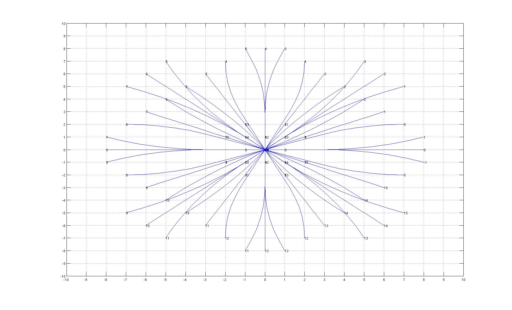

 Figure 3: Full set of motion primitives generated by the genmprim_unicycle.m matlab script for turning angles φ = kδ where k = 0,…, 15.

---

###  **3  A forward-turn-arc motion primitive**

In the following sections we describe how to build a single forward-turn-arc motion primitive. The trajectory of this motion primitive must satisfy the following requirements:

   (a)  The robot moves from the start pose (x0,y0,θ0) to the end (goal) pose (xg,yg,θg) of the primitive with fixed rotational (ω) and translational (v) velocities.      (b)  The robots travels from the start pose to the goal pose during the time interval 0 ≤ t ≤ 1. For any arbitrary time interval  0 ≤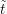 ≤ g this can be achieved using the following parameter transformation: t = 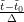, v = 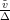, ω = 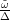, Δ = 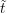 g − 0.      (c)  The trajectory of the primitive is a combination of the segment of the straight line for (0 ≤ t ≤ tl) followed by the arc of the circle of radius r for (tl ≤ t ≤ 1). The radius of the arc r represents the robot’s turning radius. Let l denote the length of the straight line segment and (xl,yl,θl) denote the start pose of the arc. Therefore, l = s(tl),xl = x(tl),yl = y(tl),θl = θ(tl) = θ0.

To build a motion primitive, we need to determine values of l,r,v,ω and tl.

The length of the path, traveled by the robot at any given time, is s(t) = vt. Specifically for t = tl, l = vtl.

When following the arc, the robot’s turning angle at any given time is Δθ(t) = θ(t) − θ0 = ω(t − tl) and the length of the arc is sarc(t) = rΔθ(t) = rω(t − tl). From the latter, r = 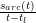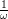 = 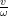.

Figure 4 displays the sample forward-turn-arc motion primitive trajectory.

---

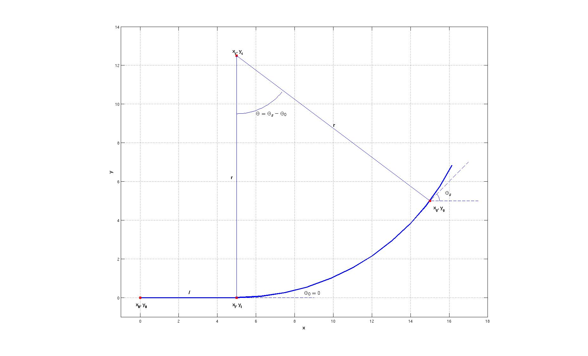

 Figure 4: The sample forward-turn-arc motion primitive with x0 = 0, y0 = 0, θ0 = 0, xg = 15, yg = 5, θg = 0.93.

---

###  **4  Straight Line Segment Of The Motion Primitive**

Consider the case of when the robot follows the straight line segment of the motion primitive with the fixed velocity v and the fixed heading θ0. As shown on Figure 5, this behavior can be described by the following equations:

  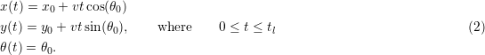

Substituting t = tl and l = vtl into (2), we get equations for the last pose of the straight line segment:

  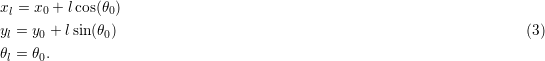

---

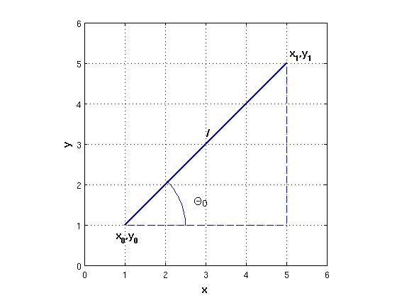

 Figure 5: Straight line segment of the motion primitive.

---

###  **5  Arc Segment Of The Motion Primitive**

Now consider the case of when the robot follows the arc of the circle with the fixed velocity v and the fixed rotational velocity ω. Derivatives 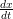 and 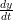 give us components of the robot’s velocity vx (in the direction of the x-axis) and vy (in the direction of the y-axis), correspondingly. As shown on Figure 6, we have the following system of three differential equations:

<table class="equation">
	<tbody>
		<tr>
			<td>
				

					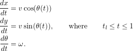</img>

			</td>
			<td class="equation-label">
				(4)</td>
		</tr>
	</tbody>
</table>

---

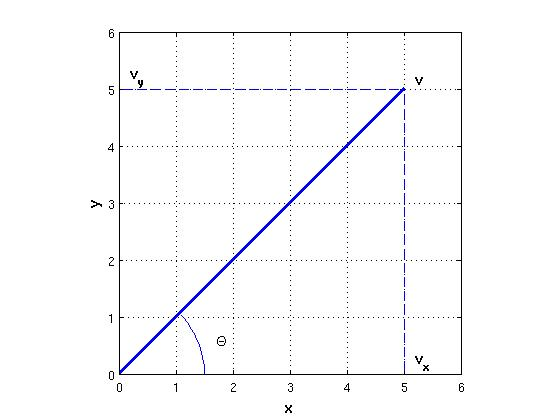

 Figure 6: Robot’s velocity components.

---

Integrating the last equation of (4), we receive:

<table class="equation">
	<tbody>
		<tr>
			<td>
				

					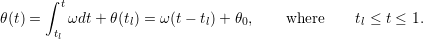</img>

			</td>
			<td class="equation-label">
				(5)</td>
		</tr>
	</tbody>
</table>

Substituting (5) into (4) gives us:

<table class="equation">
	<tbody>
		<tr>
			<td>
				

					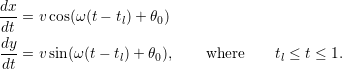</img>

			</td>
			<td class="equation-label">
				(6)</td>
		</tr>
	</tbody>
</table>

Integrating (6), we receive:

<table class="equation">
	<tbody>
		<tr>
			<td>
				

					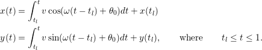</img>

			</td>
			<td class="equation-label">
				(7)</td>
		</tr>
	</tbody>
</table>

From (7), (3) and using r = , we get:

<table class="equation">
	<tbody>
		<tr>
			<td>
				

					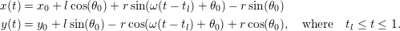</img>

			</td>
			<td class="equation-label">
				(8)</td>
		</tr>
	</tbody>
</table>

Substituting t = tg = 1 into (8), we have:

<table class="equation">
	<tbody>
		<tr>
			<td>
				

					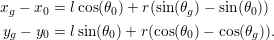</img>

			</td>
			<td class="equation-label">
				(9)</td>
		</tr>
	</tbody>
</table>

The (9) is a system of two linear equation involving variables l and r. It can be expressed in the matrix form:

<table class="equation">
	<tbody>
		<tr>
			<td>
				

					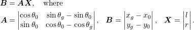</img>

			</td>
			<td class="equation-label">
				(10)</td>
		</tr>
	</tbody>
</table>

The system (10) has a unique solution:

<table class="equation">
	<tbody>
		<tr>
			<td>
				

					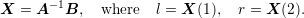</img>

			</td>
			<td class="equation-label">
				(11)</td>
		</tr>
	</tbody>
</table>

By definition, ω = 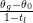. Using tl = 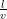 and r = 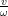, we finally get:

<table class="equation">
	<tbody>
		<tr>
			<td>
				

					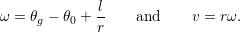</img>

			</td>
			<td class="equation-label">
				(12)</td>
		</tr>
	</tbody>
</table>

###  **6  Motion Primitive Calculation**

In the previous sections we derived formulas for all initially unknown motion parameters. Specifically using (11), we can find the length of the straight line segment (l) and the turning radius (r). From (12) we can determine both the rotational (ω) and the translational (v) velocities. Finally, using tl = 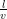 we can calculate the time, corresponding to the end of the straight line segment.

The next step is to build the motion primitive trajectory. As defined earlier in this tutorial, the numofsamples is the given number of discrete poses required on the motion primitive trajectory. Let Δt be a time step between sequential discrete poses of the trajectory. Hence Δt = 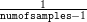. To build the motion primitive trajectory, we iterate over t = iΔt, where 0 ≤ i ≤ numofsamples-1 and use an appropriate formula to calculate each discrete pose. Specifically for t ≤ tl, we use (2) to construct the straight line segment of the motion primitive, then for tl ≤ t ≤ 1, use (8) to construct the arc portion of the motion primitive.
